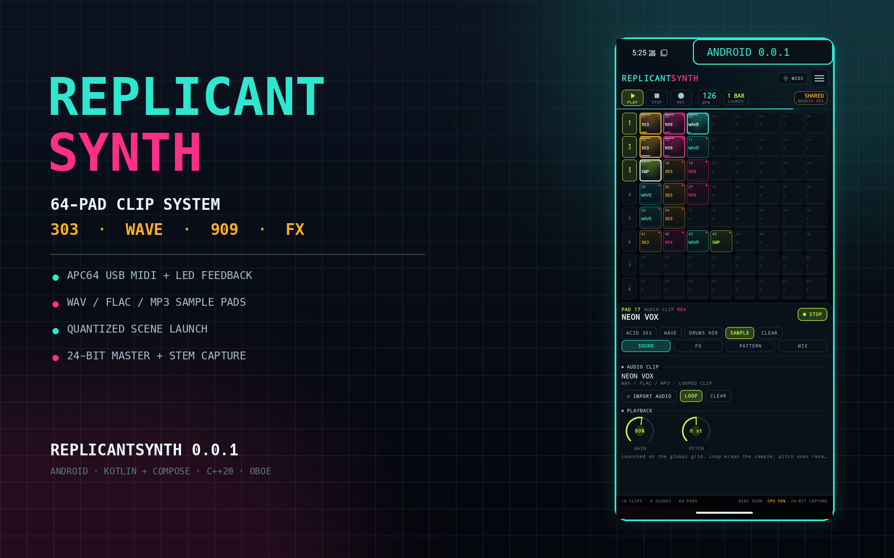
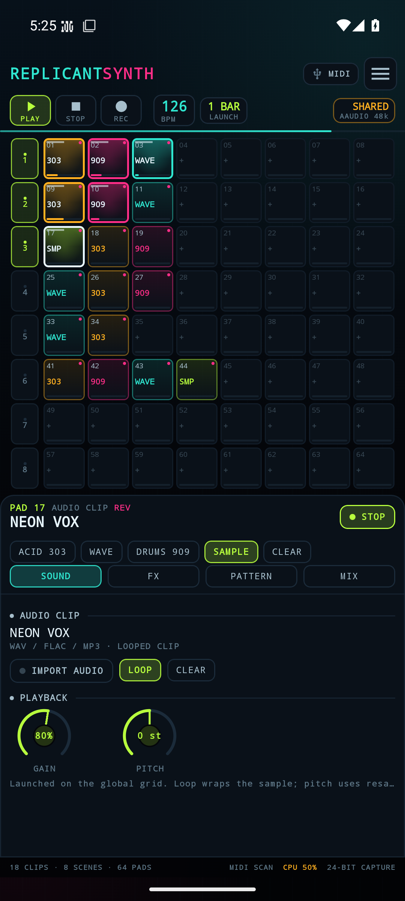
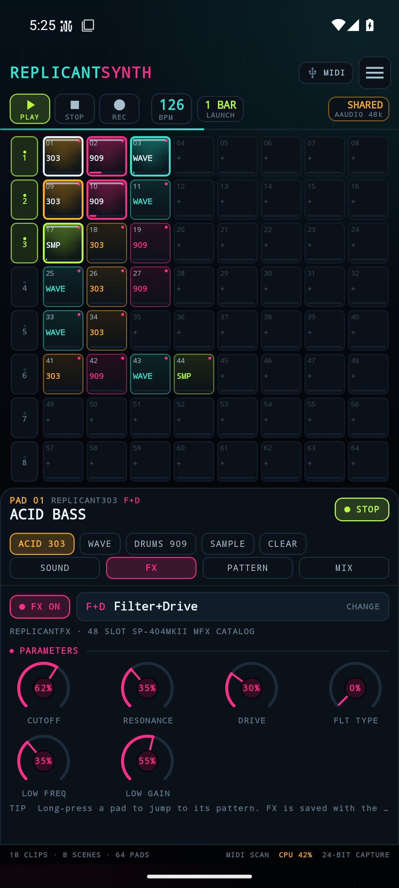
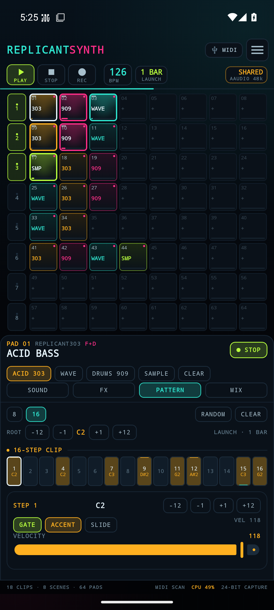
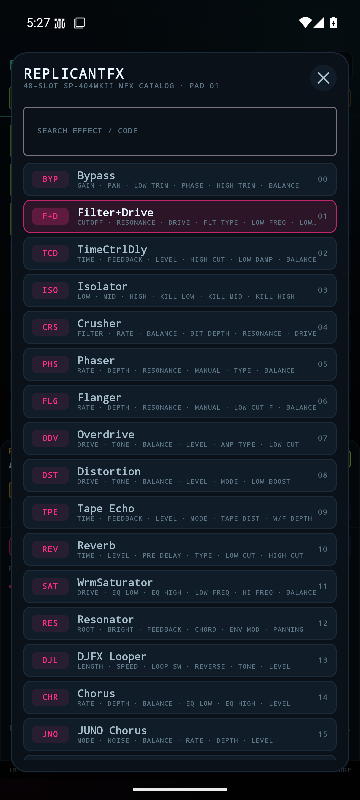
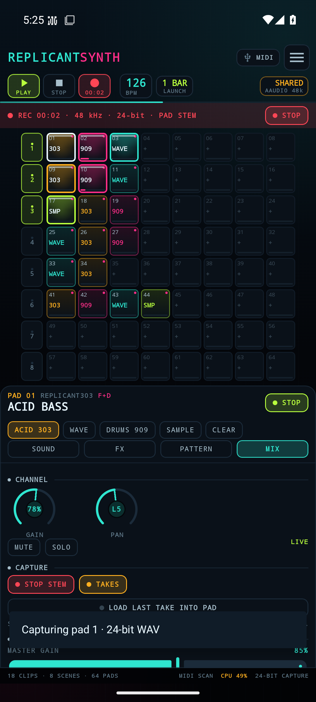
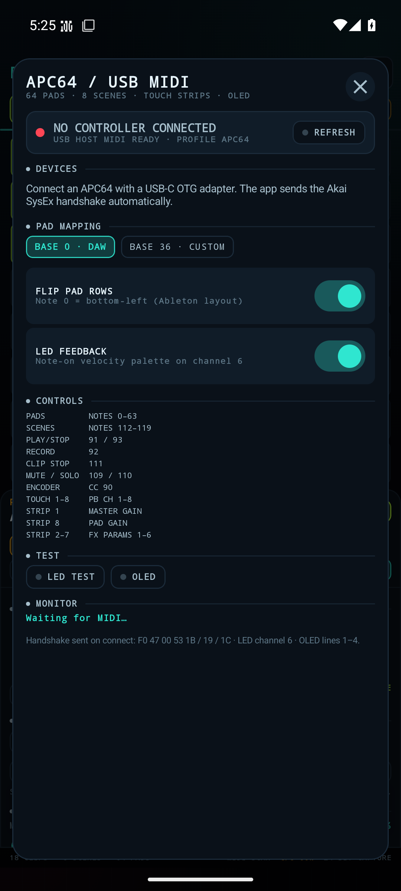
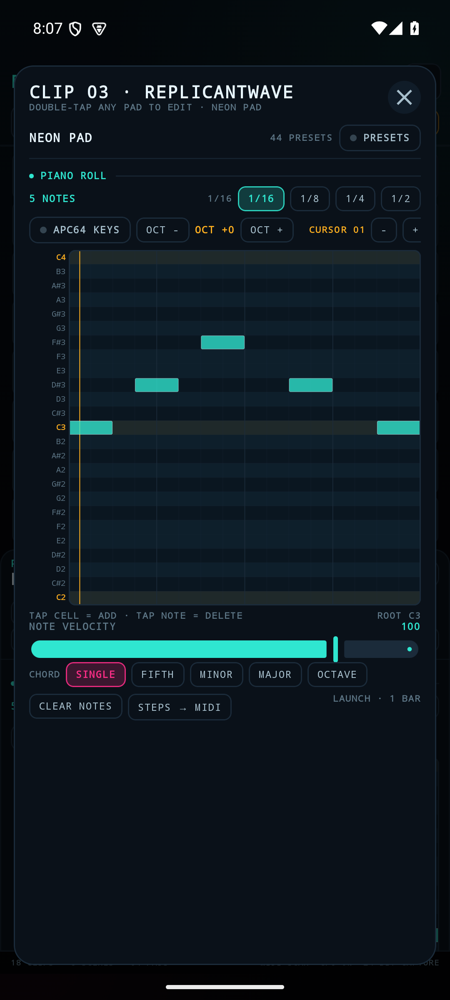
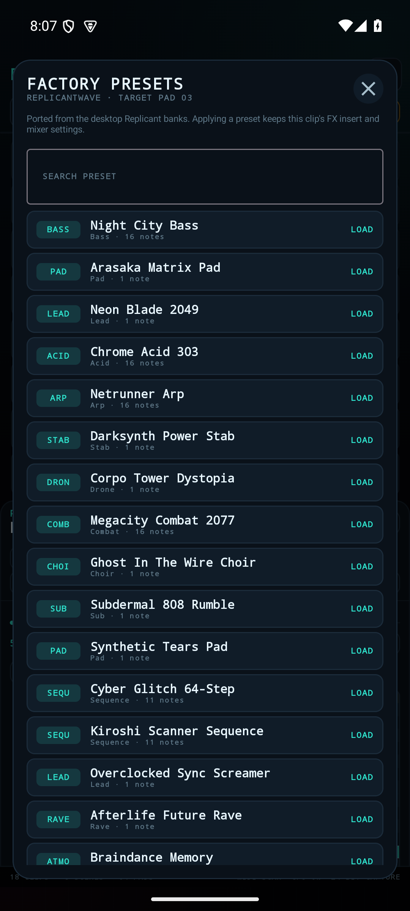
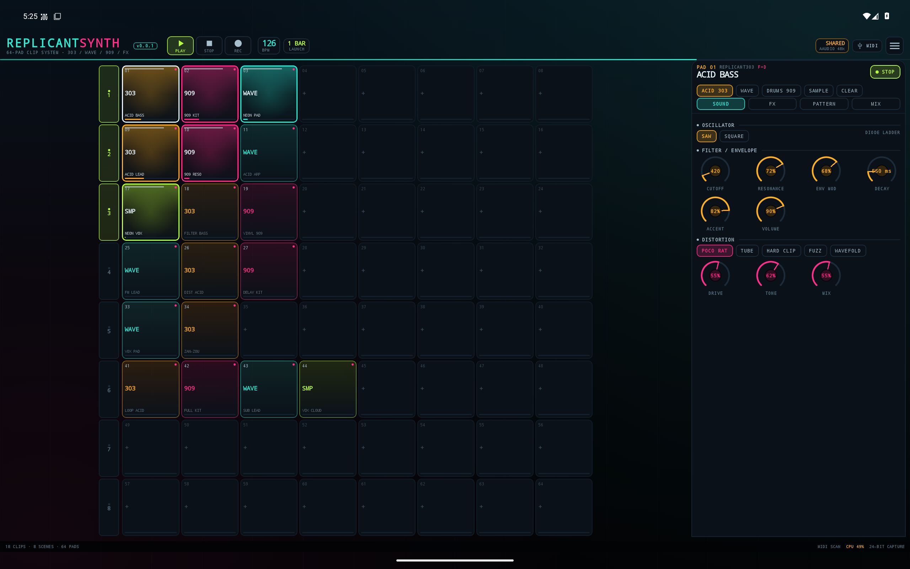

# REPLICANTSYNTH // ANDROID

<p align="center">
  <strong>A native Android clip launcher that unites Replicant303, ReplicantWave, Replicant909 and ReplicantFX on one 8 × 8 LED pad surface.</strong><br>
  <em>Kotlin + Jetpack Compose · C++20 DSP · Oboe / AAudio · USB MIDI · APC64 profile</em>
</p>

<p align="center">
  <a href="https://github.com/DanimanX/ReplicantSynthAndroid/actions/workflows/android.yml">
    
  </a>
  <a href="https://github.com/DanimanX/ReplicantSynthAndroid/releases/tag/0.0.4">
    
  </a>
  
</p>

<p align="center">
  📦 <strong><a href="https://github.com/DanimanX/ReplicantSynthAndroid/releases/tag/0.0.4">Download the Android APK (0.0.4)</a></strong>
</p>

<p align="center">
  
</p>

<p align="center">
  <em>64 pads, six demo scenes, live meters and per-pad engine / FX routing — captured from the running app.</em>
</p>

---

## What it is

**ReplicantSynth** is the Android performance surface for the four Replicant instruments. Each of the 64 pads is a clip slot with its own engine, pattern, FX insert, mixer strip and launch state. Tap a pad to launch it on the global grid; tap again to stop it; launch a scene column to fire a row at the next bar. It is the Ableton-style clip workflow, built for a phone and for the Akai APC64.

- **Replicant303** — acid bass voice, 16-step pattern, accent, slide and the five-model distortion unit.
- **ReplicantWave** — 8 wavetable banks, 16 frames per bank, 7 mip levels, up to 8 unison voices, ZDF filter, sub and noise.
- **Replicant909** — the 11 circuit-level voices from Replicant909 (BD, SD, LT, MT, HT, RS, CP, CH, OH, CC, RC) with closed-hat choke and a rebalanced linear bus.
- **ReplicantWave** — a real synth clip: a 16-step piano roll with sustained, polyphonic MIDI notes instead of a drum-style step grid.
- **ReplicantFX** — all **48** SP-404MKII MFX slots, six firmware macros per slot, one insert per pad.

Everything runs in a single C++20 engine. The UI never touches the audio thread: it sends commands through a lock-free queue and reads atomics/seqlock snapshots.

## Features

- **64 LED pads / 8 × 8 grid** with clip state (stopped, queued, playing), kind colour, FX dot, meter and step phase.
- **Ableton-style launching**: per-clip launch/stop, global launch quantization (OFF, 1/16, 1/4, 1 bar, 2 bars, 4 bars), scene launch and scene stop.
- **Per-pad engines**: switch a pad between 303, Wave, 909 and audio without leaving the grid.
- **Double-tap clip editor**: piano roll for Wave, step sequencer for 303 and the kit grid for 909, opened straight from the session clip.
- **Factory presets**: the original banks are back — 512 Replicant303 lines (8 banks × 64), the 8 Replicant909 classics and all 44 ReplicantWave sounds, with a searchable browser.
- **APC64 Note/Chord mode**: the hardware's own NOTE and CHORD modes are detected from the pad-mode SysEx report; their Notes-cable keys write into the Wave piano roll at the cursor. Session pads keep launching clips and are never hijacked by an app switch.
- **Per-pad ReplicantFX insert**: 48 effects, dynamic six-parameter labels and factory defaults from the firmware table.
- **Sample import**: WAV (PCM 8/16/24/32, float 32), FLAC, MP3, OGG, M4A/AAC; copied into app storage, looped or one-shot, pitchable.
- **24-bit capture**: master take or single-pad stem, written by a dedicated writer thread while the audio callback stays allocation-free.
- **APC64 support**: real Akai SysEx handshake, 64 pads, 8 scene buttons, transport, record, encoder, touch strips, LED feedback and OLED labels.
- **Cursor-cluster menus**: press a pad twice to open its clip editor, then the APC64's four-way cursor walks the menus — up/down change menu, left/right change field, the encoder edits the focused field and its press activates it.
- **Adaptive touch strips with LED feedback**: the eight strips mirror their values as LED bars and follow the focused menu — master and pad gain stay fixed, the middle six become the six synth knobs on SOUND, the six macros on FX, the step fields on STEPS.
- **Step Sequencer input**: the APC64's own STEP SEQ view feeds the selected clip — stopped, its pads toggle steps; playing, they record the unit's sequence quantised to 16ths — while the on-screen grids show the live playhead. The OLED mirrors page, field and value; with the editor closed the cursors move the pad selection.
- **Low latency**: Oboe with AAudio exclusive as the first choice, one-burst buffers, 48 kHz float stereo, silent-clock fallback for devices without an output route.
- **Project persistence**: JSON project with all 64 clips, patterns, FX, mixer state and sample references; autosave.
- **Adaptive UI**: phone portrait grid, tablet/landscape side inspector, edge-to-edge neon UI.

## Screenshots

<p align="center">
  
  
  
</p>
<p align="center">
  <em>64-pad clip grid · per-pad ReplicantFX insert · 16-step pattern editor</em>
</p>

<p align="center">
  
  
  
</p>
<p align="center">
  <em>All 48 ReplicantFX slots · 24-bit stem capture · APC64 profile and handshake</em>
</p>

<p align="center">
  
  
</p>
<p align="center">
  <em>ReplicantWave piano roll (MIDI notes, APC64 Note/Chord mode) · factory preset browser</em>
</p>

<p align="center">
  
</p>
<p align="center">
  <em>Wide tablet layout: the same APK at 2560 × 1600, 240 dpi.</em>
</p>

Every capture comes from the running app on an Android 15 emulator (1080 × 2400, 420 dpi; tablet 2560 × 1600, 240 dpi). No mock-ups. The audio badge reads **SHARED** because the emulator opens AAudio in shared mode; the app shows a millisecond figure only when it obtains an exclusive stream on hardware.

## Quick start

1. Install the APK from the [0.0.3 release](https://github.com/DanimanX/ReplicantSynthAndroid/releases/tag/0.0.4) on a 64-bit Android 8.0+ device.
2. Open the app. The **NEON GRID** demo is created on first launch with six scenes, a bundled vocal sample and a 303/909/Wave/FX clip on every row.
3. Tap pads `01`, `02`, `03` to launch the first scene. Use the `1 BAR` chip in the header to change launch quantization.
4. Tap a pad to select it, then use **SOUND / FX / PATTERN / MIX** in the inspector.
5. **Double-tap a clip** to open its editor: piano roll (Wave), step sequencer (303) or kit grid (909). Use **BROWSE** in SOUND to load a factory preset.
6. Press **REC** for a master take, or **MIX → RECORD STEM** for a single pad. Takes land in the app's `Recordings` folder and can be loaded into a sample pad.
7. Plug in an APC64 with a USB-C OTG adapter and open the **MIDI** chip. The app sends the handshake and mirrors clip state to the pads.

## Demo audio

A 41-second arrangement rendered by the real engine (all four instruments, six scenes, per-pad FX):

[`assets/replicantsynth_demo.mp3`](assets/replicantsynth_demo.mp3)

The arrangement is generated by `host/render_demo.cpp` through the same clip engine and 24-bit capture path used by the app.

## APC64 mapping

| Control | Message | Action |
| --- | --- | --- |
| 64 pads | Notes 0–63, note 0 = bottom-left | Launch / stop / select clip |
| Scene buttons | Notes 112–119 | Launch row; long-press (on-screen) stops row |
| Play / Stop | Notes 91 / 93 | Transport start / stop |
| Record | Note 92 | Toggle master capture |
| Clip Stop | Note 111 | Stop all clips |
| Mute / Solo | Notes 109 / 110 | Toggle selected pad mute / solo |
| Notes / Chord surface | Notes cable, pitches 0–127 | Write keys into the Wave piano roll; Chord mode groups simultaneous notes |
| Cursor up / down / left / right | Notes 94 / 95 / 96 / 97 | Walk the clip-editor menus; move the pad selection when the editor is closed |
| Encoder | CC 90 (two's complement) | Nudge BPM; edits the focused menu field |
| Encoder press | Note 90 | Activate the focused menu field |
| Touch strips | Pitch-bend channels 1–8 | Strip 1 master, 8 pad gain, 2–7 the focused menu's six fields |
| Strip LEDs | Pitch bend + CC 104–111 / 112–119 | Bar position, style and colour |
| Strip touch | Notes 82–89 | Focus that strip's field |
| LEDs | Note-on, channel 6 / 0 / 14 | Full / half / blink brightness |
| OLED | SysEx 0x10 / 0x1A | `REPLICANT`, `SYNTH`, BPM, quantize |

The app sends the Akai mode handshake on connect:

```
F0 47 00 53 1B 00 01 00 F7   track type
F0 47 00 53 19 00 01 00 F7   generic/DAW mode
F0 7E 7F 06 01 F7            identity request
F0 47 00 53 1C 00 01 01 F7   take display ownership
F0 47 00 53 10 ... F7        OLED labels
```

The app opens the **DAW** and **Notes** USB MIDI cables separately (by name, falling back to cable 0/1) and reads the unit's pad-mode report `F0 47 00 53 19 00 01 <m> F7`. On firmware **1.2.1.6** the validated mode map is `0` Session, `2` Note, `3` Chord, `6` Step, `8` Project, `9` Custom. Note/Chord pads arrive on the Notes cable; the DAW pad grid is only treated as clips in Session/Overview. The identity reply is parsed so the MIDI sheet shows the connected firmware.

A **BASE 0 / BASE 36** switch and a **FLIP PAD ROWS** switch cover stock Ableton DAW mode, the Akai custom project layout and FreeAPC64 firmware. See [docs/MIDI_APC64.md](docs/MIDI_APC64.md) for the full protocol notes and troubleshooting.

## Build

Requirements: JDK 17, Android SDK 36, NDK `27.0.12077973`, CMake `3.22.1`, Gradle wrapper 8.11.1.

```bash
echo "sdk.dir=/path/to/android-sdk" > local.properties
JAVA_HOME=/path/to/jdk17 ./gradlew :app:assembleDebug
JAVA_HOME=/path/to/jdk17 ./gradlew :app:testDebugUnitTest
```

APK: `app/build/outputs/apk/debug/app-debug.apk`.

Host DSP suite (no Android required):

```bash
cmake -S host -B build-host -DCMAKE_BUILD_TYPE=Release
cmake --build build-host -j
./build-host/engine_tests
```

The release APK is signed with the debug key unless the four `REPLICANT_KEYSTORE*` environment variables are present. CI builds and publishes it on every `0.*` tag.

More detail: [docs/BUILD.md](docs/BUILD.md), [docs/ARCHITECTURE.md](docs/ARCHITECTURE.md), [docs/PRESETS.md](docs/PRESETS.md), [docs/RELEASING.md](docs/RELEASING.md) and the [changelog](CHANGELOG.md).

## Verification

- **36,112 host checks** across wavetables, 303, 909 headroom, MIDI-note polyphony/release, Wave, sample playback, all 48 FX, quantized launch, scenes, recording, 44.1 kHz re-prepare and peak guard. `0 failures`.
- **67 JVM unit tests** for WAV decoding, project JSON (including MIDI notes), APC64 pad-mode/firmware/port mapping, cursor-cluster and strip-touch notes, strip LED frames, editor menu navigation, the adaptive strip layout, the Step Seq clock, LED palette, SysEx handshake, MIDI stream parsing, chord grouping, clip defaults, the 512-slot 303 generator and all three factory banks. `0 failures`.
- **Real emulator run**: on-device screenshots, project load, demo sample decode, clip launching, FX switching, recording and MIDI sheet. A captured stem was verified with `ffprobe` as `pcm_s24le`, 48 kHz stereo, 3.74 s, peak 0.40. The emulator reports AAudio shared mode; latency is a hardware measurement, not an emulator claim.
- **APC64 hardware**: the protocol, handshake and mappings are covered by unit tests; a physical APC64 was not attached to the CI runner. Please report device-specific quirks.

## Architecture

```
Compose UI (Kotlin)
  │  commands: configure / params / steps / launch / capture
  ▼
JNI bridge (lock-free command queue, atomics)
  ▼
ClipEngine (C++20)
  ├── 64 Clip slots: 303 · Wave · 909 · Sample
  ├── per-pad ReplicantFX (48 slots)
  ├── 16th transport, quantization, scenes, tails
  └── 2 × Recorder (24-bit WAV writer thread)
  ▼
Oboe → AAudio exclusive / shared → OpenSL ES fallback
```

Full design notes: [docs/ARCHITECTURE.md](docs/ARCHITECTURE.md).

## Project layout

```
app/src/main/java/com/danimanx/replicantsynth/
  audio/      NativeEngine, EngineController, Oboe service, decoders, capture
  midi/       APC64 profile, SysEx/LED codec, incremental MIDI parser
  model/      clips, MIDI notes, FX catalog, presets, demo project, JSON store
  ui/         Compose grid, inspector, piano roll editor, sheets, ViewModel
app/src/main/cpp/
  core/       303, 909, wavetable, FX, clip engine, recorder
  audio/      Oboe driver
  jni_bridge.cpp
host/         DSP regression suite + demo renderer
```

## Known limits / roadmap

- **One insert per pad.** ReplicantFX's dual-bus serial/parallel routing is a desktop feature; 0.0.3 runs one selected slot per pad.
- **The wavetable port is an architecture port**, not a byte-for-byte Rust port: same 8 banks, morphing, unison, sub/noise and ZDF filter, implemented in C++ for the shared engine. The 44 Wave presets map osc 1, sub, noise, filter and amp; desktop osc 2 / chorus / delay / reverb become the per-pad ReplicantFX insert.
- **The piano roll is one 16-step bar.** Notes can start on any step and sustain up to 16 steps; longer desktop sequences are truncated to their first bar.
- **Samples loop by length**, not by musical time-stretch. Pitch is resampling.
- **5-minute sample / capture cap** in the native sample player.
- **APC64 touch strips** are mapped to master, pad gain and the six FX macros; per-strip assignment is a roadmap item.
- **MIDI 2.0 / UMP** is not used by the APC64's class-compliant USB MIDI 1.0 interface.

## License

MIT. The four upstream instruments are MIT by the same author. See [LICENSE](LICENSE) and [NOTICE](NOTICE).

ReplicantSynth is free and open source. If it earns a place in your setup, you can buy me a coffee — completely optional:

[paypal.me/DanimanX](https://paypal.me/DanimanX?locale.x=en_US&country.x=CL)
